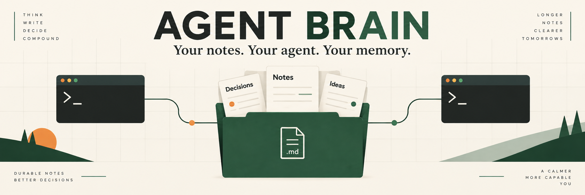
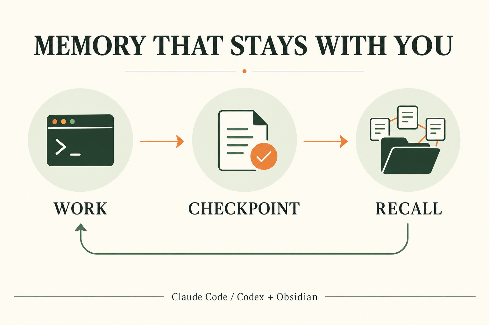

# Agent Brain



Give **your terminal coding agent** (Claude Code, Codex CLI, GitHub Copilot CLI,
Kiro CLI, Qwen Code or Factory Droid, any mix) a private Obsidian vault it can
maintain and recall across sessions. One public setup with only the skills and tools
needed for the Brain workflow. Your notes stay on your computer.

## Install

Have **Obsidian** and **Python 3.10+** installed. Guided setup checks these,
lets you choose your agents and vault folder, and offers the official installer
if Claude Code or Codex is missing. Nothing else is required.
You do not need Git, a GitHub account, or another repository.

All three Brain workflow skills and their supporting tools are included here.

**macOS / Linux** (Terminal with Bash or Zsh):

```bash
bash <(curl -fsSL https://raw.githubusercontent.com/gabz147/agent-brain/main/bootstrap.sh)
```

**Windows** (PowerShell):

```powershell
& ([scriptblock]::Create((Invoke-RestMethod https://raw.githubusercontent.com/gabz147/agent-brain/main/bootstrap.ps1)))
```

Setup previews its changes and asks before applying them. It configures Brain
paths for your chosen agents, creates the vault, and checks the installed
workflow. Then open the printed folder in Obsidian, restart/sign into your CLI,
and follow [your first checkpoint](FIRST-CHECKPOINT.md).

Missing Python? See [prerequisites and troubleshooting](docs/setup.md#prerequisites).
Prefer to inspect the download first? Use the
[download-and-inspect method](docs/setup.md#download-and-inspect).

### Release bundle (preview)

`get.sh` and `get.ps1` download a tagged release's `brain.pyz` (a reproducible
zipapp built by `tools/build_pyz.py`) and its `SHA256SUMS`, refuse a mismatch,
then run `python brain.pyz setup --wizard`. The checksum proves the download is
intact, not who published it: both files come from the same GitHub release. To
verify a release yourself, rebuild it from the tag with
`python tools/build_pyz.py --version <tag>` and compare the hash. The commands
above keep using the current installer until the v2 bundle has been dogfooded.

### Clone or ask your agent

With Git installed, clone this repository and run its guided setup:

```bash
git clone https://github.com/gabz147/agent-brain.git
cd agent-brain
python3 install.py --wizard
```

Use `python` instead of `python3` on Windows. Or open the checkout in Claude
Code or Codex and ask:

> Read SKILL.md and set up Agent Brain for me. Use this repository for the
> complete vault system and required skills.

[The Agent Brain setup skill](SKILL.md) guides the agent through the same
installer. Copying a skill file alone does not install the controller, vault or
hooks; setup installs them together from this one repository.

## What you get

| Component | Purpose |
|---|---|
| Starter vault | A blank profile, priorities, decisions, project index, daily notes and native Home dashboard |
| Obsidian templates | Configured Daily Notes and Templates on a fresh vault |
| `obsidian-vault` | Retrieve context and maintain notes using shared writing rules |
| `handoff` | Leave a usable continuation point for the next session |
| `source-to-vault` | Turn reviewed source material into traceable notes |
| Startup instructions | Load relevant context on demand; checkpoint substantive work and decisions |
| Shared writer | Validate notes, preserve history, back up changes and return compact verified receipts |
| On-demand actions | Read-only link checks, inbox triage, next actions and evidence freshness |
| Claude hooks, if selected | Inject the startup brief, remind Claude to checkpoint and validate completed Markdown writes |

No personal skill bundle, unrelated plugins, credentials or prewritten personal
notes are installed. Existing notes and unrelated client settings are preserved.
Client accounts and usage costs remain your own.

## How it works



The agent starts with a compact boot policy. On Claude Code a SessionStart hook
injects a short brief, about 200 tokens: the latest Open line, the last session
headings, Active Now and any recent hook errors. Codex, which has no hooks here, is
instructed to run `vaultctl.py session-brief` once instead. Greetings and self-contained
questions need no vault reads. For substantive project work, it reads the map
and relevant notes. Priorities are for status/continuation, daily history starts
with compact Open/session navigation and relevant complete sessions, and workflow sections load before writing.
Compaction reloads only missing context for the current task.

It saves substantial findings, decisions and handoffs through the shared writer,
then appends a verified daily checkpoint. Any agent can checkpoint: Claude Code and Codex bind
the receipt to their transcript, other agents attest with their model id and
summary flags. Each changed note gets an automatic
readable local write timestamp with 12-hour time, seconds and timezone in `updated`, for example
`September 23, 2026 at 6:20:14 AM (UTC-06:00)`. Existing date-only notes remain valid. Future sessions retrieve that context
from the same Markdown files you see in Obsidian.

Claude has a Stop-hook reminder. Codex checkpoints through startup instructions
and skills. This guides agent behavior; the [first-checkpoint check](FIRST-CHECKPOINT.md)
confirms it works with your account, permissions and installed client version.
Brief replies need not become notes.

## Platforms and optional features

The core installer, vault writer and live checkpoints support **Windows, macOS
and Linux**, for any one agent or any mix. Your chosen
CLI must also support your OS/version. WSL is a separate Linux installation.

Checkpoints are live only: the agent writes them inside its own session, and
nothing in this package starts a model call in the background. The former
optional Windows retrospective-capture drain was removed because it spent plan
usage on unattended runs. A scheduled `hygiene --fix` (no model calls) is a one-line
entry in [your OS's scheduler](docs/scheduling.md); a guarded Windows audit task, a
debug-port link checker and the Agent Pulse indicator are optional, in [contrib/](contrib/README.md).

This installs a template, not a cloud sync service. Keep actual notes and runtime
state outside this public repository. Configure your own private backup or
Obsidian Sync separately if wanted.

## Updates and maintenance

Rerun the same setup command to review an update. Differing workflow files need
explicit replacement and get local backups. Existing notes, vault settings,
custom schema, queues and receipts remain intact. Installed agents keep their
configured vault unless you choose a different path, and an existing controller
folder stays where it is.

Timestamp upgrades also preview a checked migration of the contract's known
legacy timestamp schema rule. The writer snapshots that change; custom wording is left
for review. Historical note timestamps are not backfilled.

The updated shared boot block replaces older blanket startup reads, including
those retained in existing vault notes. User-specific instructions outside that
block are preserved; reconcile any separate full-startup requirement manually.
See [context loading and measurement](docs/context-loading.md) for the budget,
upgrade behavior and a reproducible size check.

- [Setup, troubleshooting, manual installation and upgrades](docs/setup.md)
- [Per-agent notes](docs/agents/), generated from `automation/adapters/`
- [Scheduling hygiene](docs/scheduling.md) and optional extras in [contrib/](contrib/README.md)
- [First checkpoint and recall](FIRST-CHECKPOINT.md)
- [Automation reference](automation/README.md)
- [Graphics and prompts](docs/graphics/README.md)

From a reviewed checkout, run `python3 -m unittest discover -s automation/tests -q`
(`python` on Windows). [CI](https://github.com/gabz147/agent-brain/actions) checks
all three OS families using isolated homes, preservation/upgrade tests and
source-bound checkpoint fixtures. Tests do not write your real vault or make
paid model calls. GUI/account acceptance is a separate first-checkpoint step.

[MIT license](LICENSE).
